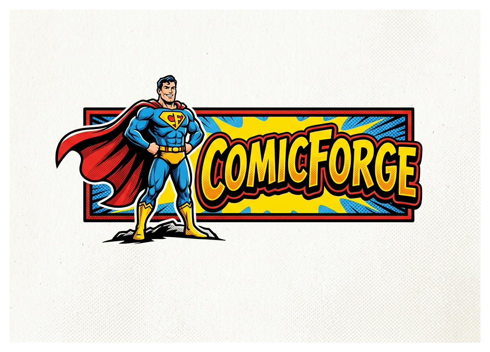

# ComicForge



ComicForge turns a vocabulary file into a generated comic package. It uses Gemini-backed providers to write a story, draw comic pages, and optionally produce narration. The CLI writes the finished assets into `./comics/<slug>/` and can also assemble a PDF.

## What It Does

ComicForge reads a vocabulary list, generates a story from those words, renders comic pages, and saves supporting files alongside the comic. By default it uses Gemini for text, image, and text-to-speech generation.

Generated output includes:

- story text
- vocabulary recap
- theme file
- comic page PNGs
- PDF output when page rendering succeeds
- narration MP3 when narration is enabled and a TTS provider is available

## Installation

Build and test with Mage:

```bash
mage build
mage test
mage install
```

Or build directly:

```bash
go build -o comicforge ./cmd/comicforge
```

The `mage install` target copies the binary into `$GOPATH/bin` and falls back to `~/go/bin` when `GOPATH` is not set.

## Configuration

ComicForge loads configuration from:

1. `--config <file>` when provided
2. `~/.config/comicforge/config.yaml`
3. `~/config.yaml`
4. `./config.yaml`

Environment variables also work. `COMICFORGE_` is the prefix, and dots in config keys become underscores. Examples:

- `COMICFORGE_API_GOOGLE_API_KEY`
- `COMICFORGE_PROVIDER_TEXT`
- `COMICFORGE_MODELS_IMAGE`
- `COMICFORGE_COMIC_STORY_PAGES`

Start from [`config.yaml.example`](config.yaml.example). The important settings are:

```yaml
provider:
  text: gemini
  image: gemini
  tts: gemini

api:
  google_api_key: ""

models:
  text: gemini-2.5-flash
  image: gemini-3.1-flash-image-preview
  image_text: gemini-2.5-flash
  tts: gemini-2.5-flash-preview-tts

comic:
  story_pages: 5
  gallery_pages: 5
  panels_per_page: 4

prompts_dir: ./prompts
```

`provider.*` currently supports Gemini in this codebase. Set `api.google_api_key` or `COMICFORGE_API_GOOGLE_API_KEY` for Gemini-backed generation.

## Usage

ComicForge requires a vocabulary file:

```bash
comicforge --vocab words.txt --config config.yaml --output out
```

Vocabulary lines can be:

- `ябълка = apple`
- `котка == домашно животно`
- `стол`
- `= translation only`

Useful flags:

- `--output` sets the root output directory
- `--prompts-dir` overrides the prompt template directory
- `--style` and `--theme` override story generation hints
- `--slug` forces the output folder name
- `--narrate` enables narration output
- `--narrator-voice` picks the Gemini narration voice
- `--text-provider`, `--image-provider`, `--tts-provider` override provider names
- `--text-model`, `--image-model`, `--image-text-model`, `--tts-model` override model IDs
- `--ultra-realistic` and `--no-ultra-realistic` control the rendering mode
- `--version` prints the application version

Example:

```bash
comicforge \
  --vocab vocab.txt \
  --config config.yaml \
  --output out \
  --slug demo-comic \
  --narrate
```

The generated files are written under `out/comics/demo-comic/`.

