# ComicForge Architecture

This document describes the architecture of **ComicForge**, a Go CLI application that generates AI-powered comic books from vocabulary word lists or direct prompts.

## Table of Contents

1. [High-Level Overview](#high-level-overview)
2. [System Architecture](#system-architecture)
3. [Package Structure](#package-structure)
4. [Data Flow](#data-flow)
5. [Provider Architecture](#provider-architecture)
6. [Configuration System](#configuration-system)
7. [Comic Generation Pipeline](#comic-generation-pipeline)
8. [Key Design Patterns](#key-design-patterns)

---

## High-Level Overview

ComicForge is a command-line tool that orchestrates multiple AI providers to produce complete comic books. Given a vocabulary file containing words in a target language, it:

1. Generates a story incorporating those words
2. Creates a character bible for visual consistency
3. Renders comic pages (cover, story pages, gallery, back cover)
4. Assembles a PDF
5. Optionally generates cinematic audio narration

---

## System Architecture

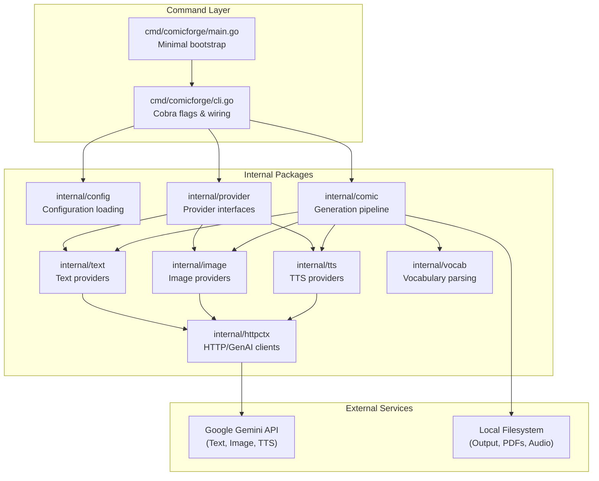

---

## Package Structure

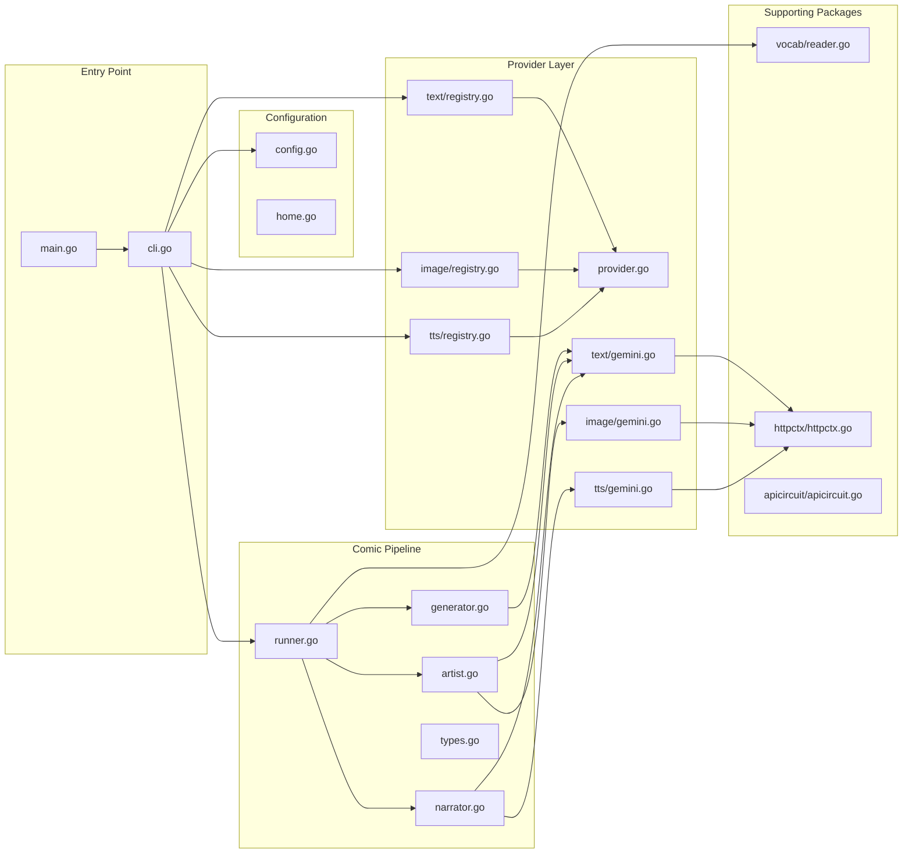

---

## Data Flow

### Vocabulary Mode (Full Comic)

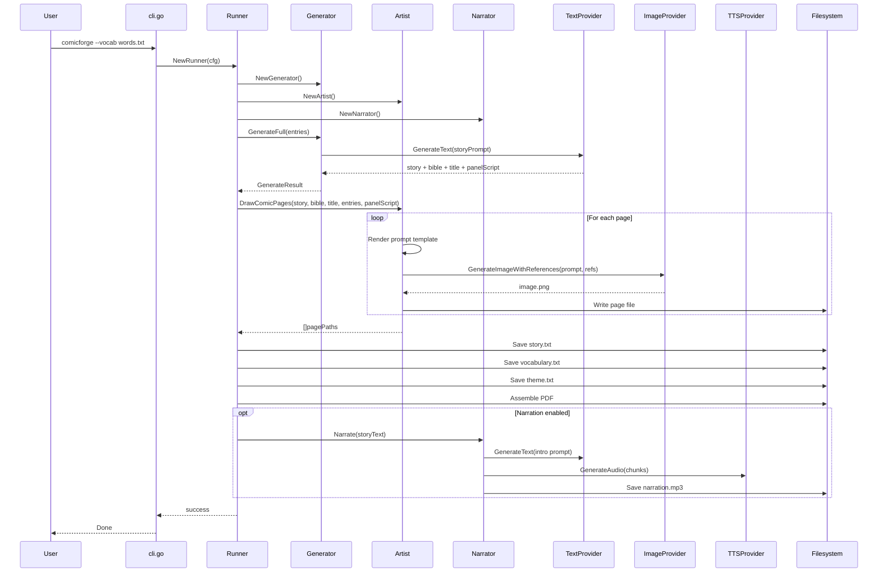

### Prompt Mode (Single Image)

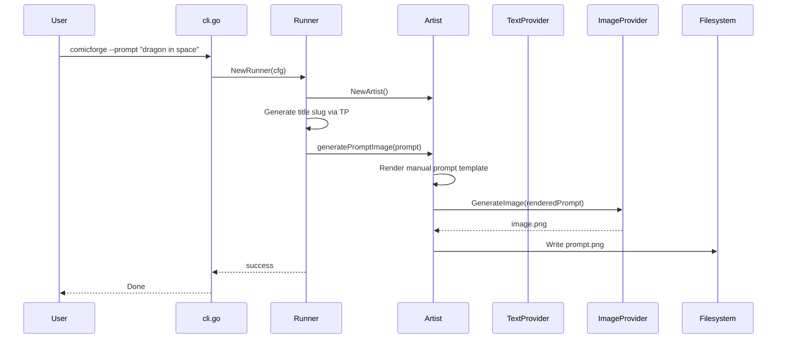

---

## Provider Architecture

ComicForge uses a **registry-based provider system** that abstracts over different AI backends. Currently, only **Google Gemini** is fully implemented; OpenAI is stubbed for future extension.

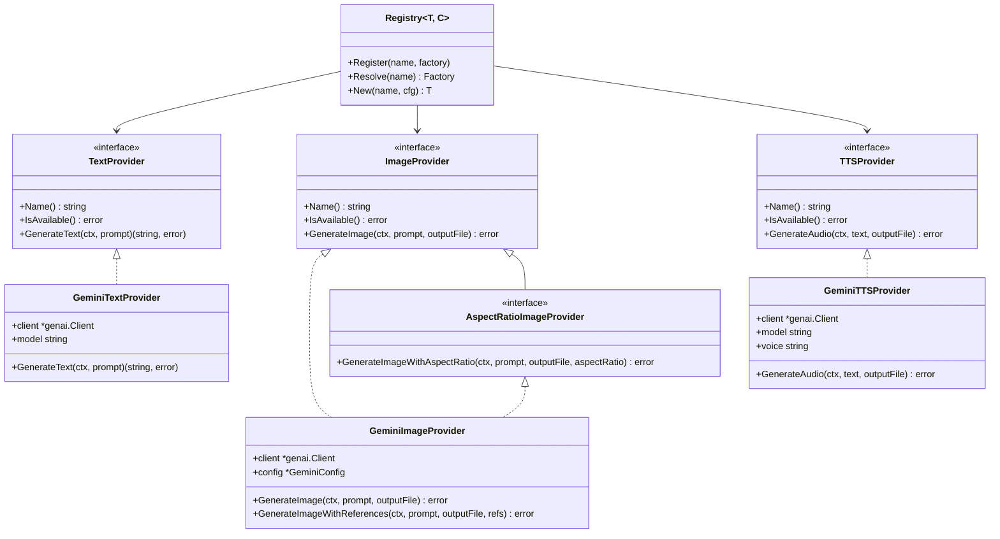

### Provider Registry Flow

```mermaid
graph LR
    A[CLI Flags<br/>--text-provider gemini] --> B[Config.Normalize]
    B --> C[Registry.Resolve"gemini"]
    C --> D[Factory Function]
    D --> E[GeminiProvider]
    E --> F[IsAvailable Check]
    F --> G[Inject into Runner]
```

---

## Configuration System

Configuration is loaded via **Viper** with a three-layer priority:

1. **Defaults** (code-defined)
2. **Config file** (`config.yaml`)
3. **Environment variables** (`COMICFORGE_*`)
4. **CLI flags** (highest priority)

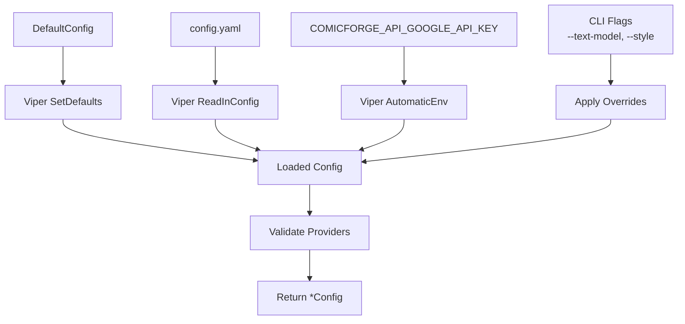

The `Config` struct implements multiple small interfaces so each package only depends on what it needs:

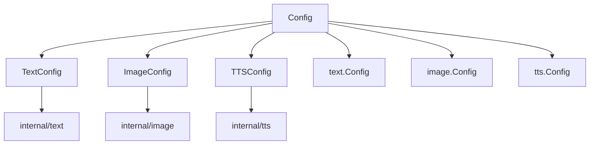

---

## Comic Generation Pipeline

The pipeline is divided into three specialized stages:

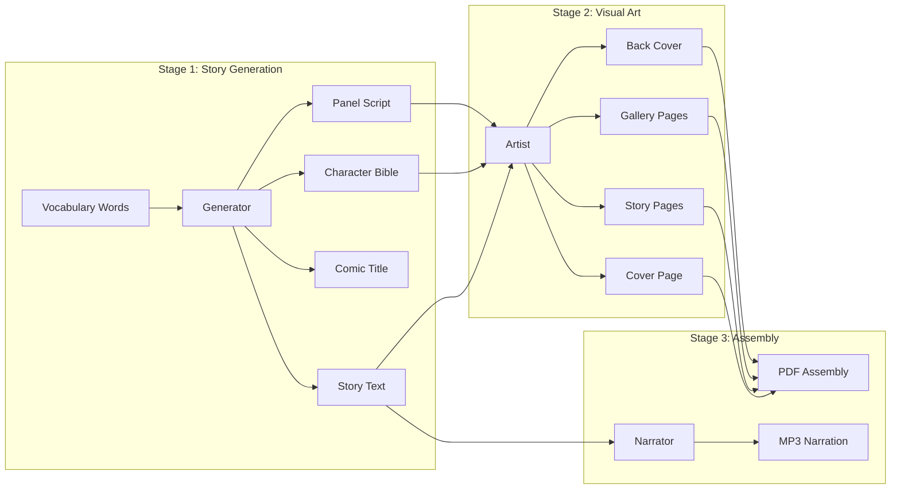

### Reference Image Chaining

To maintain visual consistency across comic pages, the Artist passes previous page images as **reference images** to the image provider:

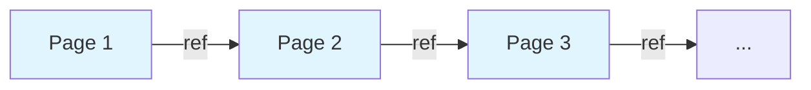

The `appendRef` function keeps only the **first and most recent** reference images to avoid exceeding API limits.

---

## Key Design Patterns

### Dependency Injection

The CLI uses a `commandDeps` struct to inject provider factories, making the entire command layer testable without real API calls:

```go
type commandDeps struct {
    loadConfig       func(string) (*config.Config, error)
    newTextProvider  func(*config.Config) (provider.TextProvider, error)
    newImageProvider func(*config.Config) (provider.ImageProvider, error)
    newTTSProvider   func(*config.Config, string) (provider.TTSProvider, error)
    newRunner        func(*comic.RunnerConfig) comic.StoryRunner
}
```

### Template-Driven Prompts

All LLM prompts are **Go text/template files** rendered with structured data. Templates live in `prompts/` and can be overridden at runtime via `--prompts-dir`:

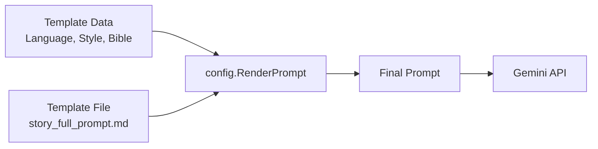

### Circuit Breaker

The `internal/apicircuit` package provides circuit breaker protection for API calls to prevent cascading failures when AI providers are unavailable.

### Defensive Defaults

Every component uses the **functional options / config struct** pattern with sensible defaults:

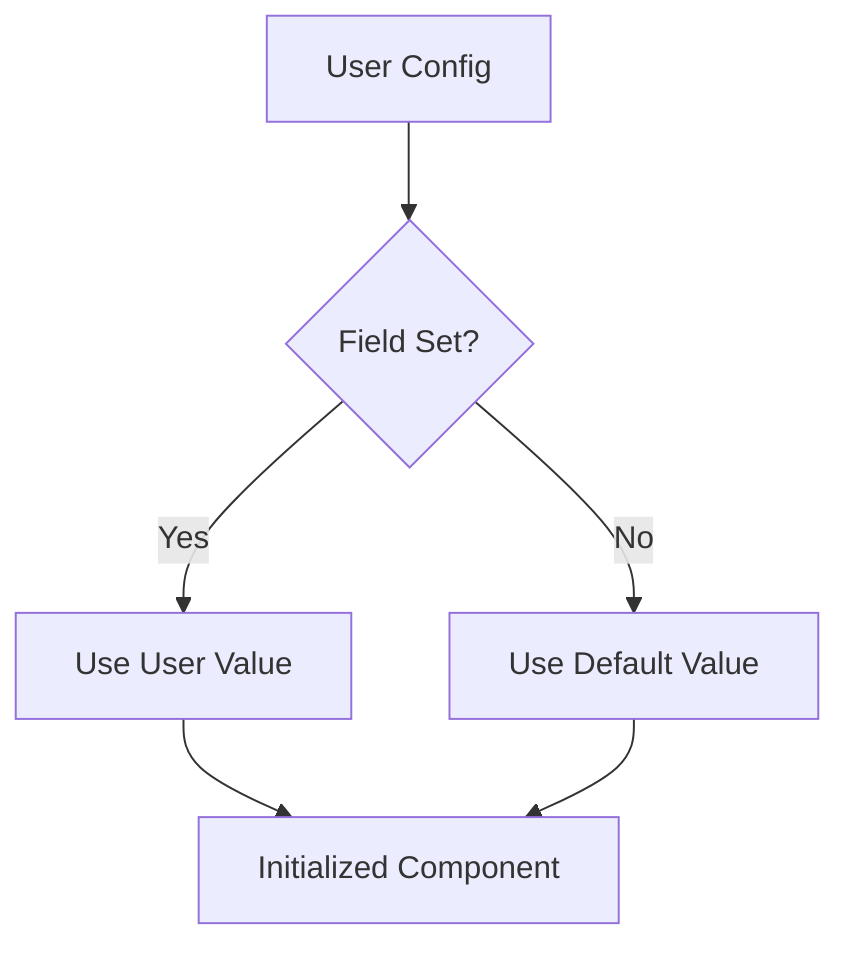

---

## File Output Structure

When running with `--output .` and a comic titled "Space Adventure":

```
comics/
├── assets/
│   └── space-adventure/
│       ├── space-adventure_cover.png
│       ├── space-adventure_page_1.png
│       ├── space-adventure_page_2.png
│       ├── space-adventure_gallery_1.png
│       ├── space-adventure_back.png
│       ├── space-adventure_story.txt
│       ├── space-adventure_comic_vocabulary.txt
│       ├── space-adventure_theme.txt
│       └── space-adventure_narration.mp3
├── PDF/
│   └── space-adventure.pdf
└── gallery/
    ├── space-adventure_gallery_1.png
    └── ...
```

---

## Technology Stack

| Component | Technology |
|-----------|------------|
| Language | Go 1.23+ |
| CLI Framework | Cobra |
| Configuration | Viper |
| AI Provider SDK | `google.golang.org/genai` |
| PDF Generation | Custom assembly via `internal/comic/pdf.go` |
| Audio Processing | `ffmpeg` (external dependency) |
| Testing | Go standard testing + test tables |
| Module Path | `codeberg.org/snonux/comicforge` |

---

## Future Extension Points

- **New AI Providers**: Implement `TextProvider`/`ImageProvider`/`TTSProvider` and register in the respective registries
- **New Style Modes**: Add to `StyleConfig` and update `pickStyle()` in `types.go`
- **Custom Output Formats**: The `assemblePDF` field in `Runner` is injectable for alternative exporters; the default implementation takes `PDFAssembleOptions` (density, JPEG quality, print-style matting)
- **Additional Languages**: Extend `localization.go` with new script/language mappings
