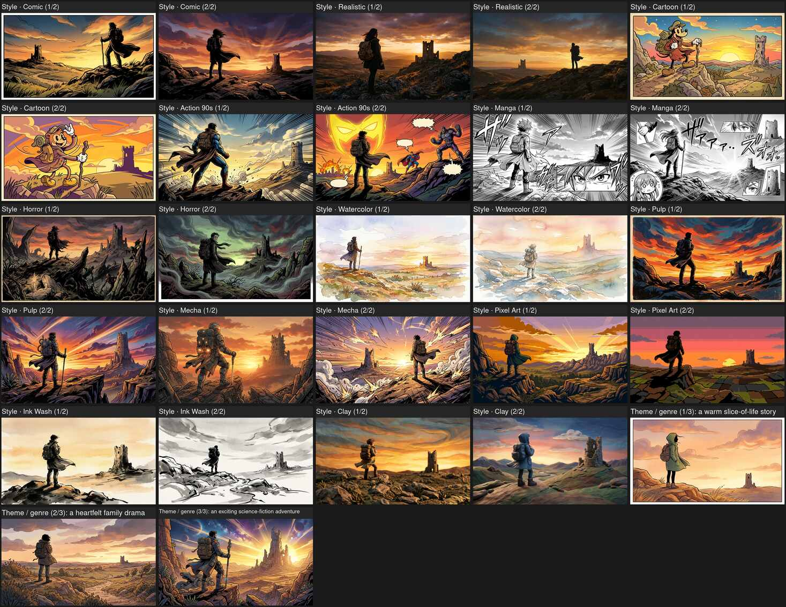

# Style and theme reference sheet

[Back to README](../README.md)

To compare **every** line in `styles.*` plus **every** `story.genres` entry on one montage (shared test scene, header above each cell), use the helper command. It calls the configured image provider once per cell and requires ImageMagick **`montage`** as well as **`convert`**.

```bash
go run ./cmd/stylegrid --config config.yaml --output stylegrid.png
```

Flags: `--scene` (override the shared scene), `--aspect-ratio` (default `16:9`), `--timeout` (default 45m). With default `config` this produces **24** style variants + **3** genre panels = **27** images. Regenerate after editing style or genre lists in YAML.

`mage stylegrid` writes `stylegrid.png` in the repo root via the same command.

Example preview (downscaled JPEG; full-resolution grid is much larger):



See [Style selection](CONFIGURATION.md#style-selection) for how styles are chosen during comic generation.
